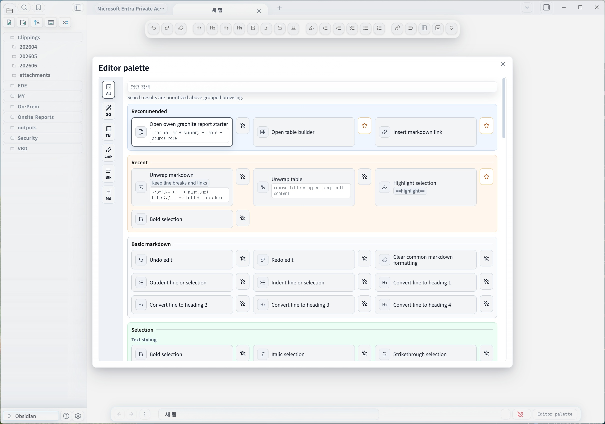
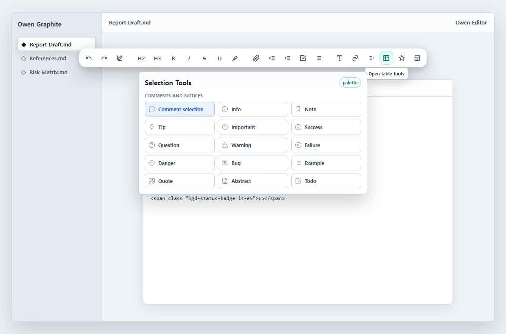
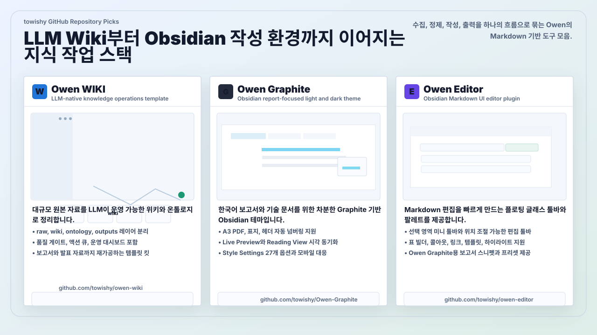
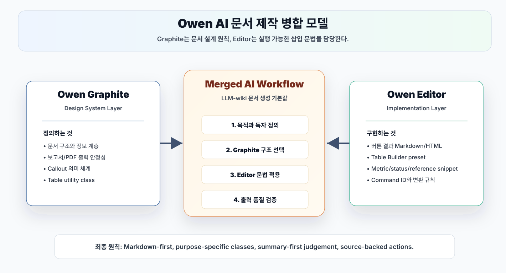
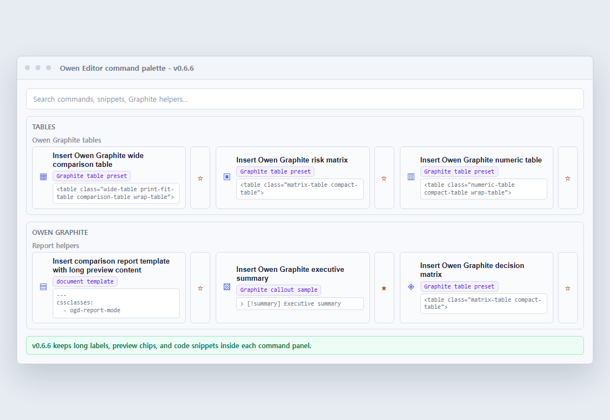
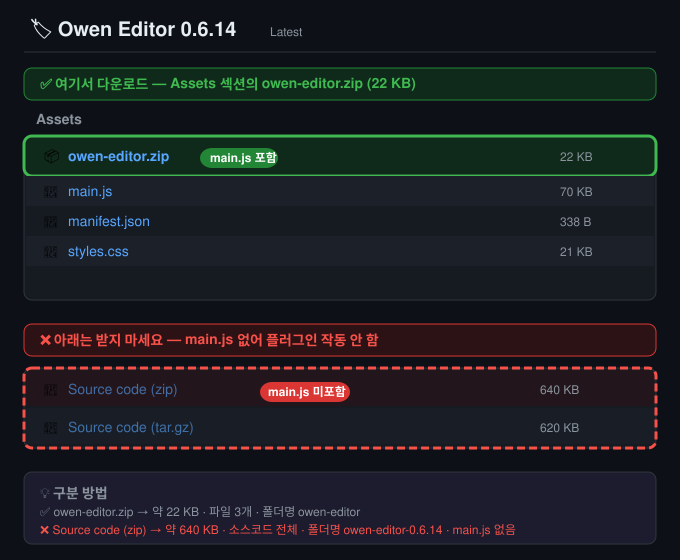
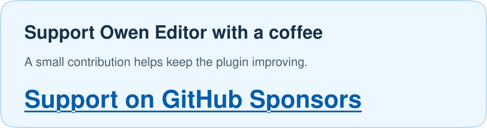

[](https://github.com/towishy/owen-editor/releases/latest)
[](LICENSE)
[](https://obsidian.md)
[](#compatibility-and-boundaries)

<br>
<br>
<br>


<br>

## The Owen stack

Pick the tool for the part of the workflow you want to improve. These projects work together, but you do not need to install everything.

| Project | Its role in your workflow |
| --- | --- |
| [Owen Graphite](https://github.com/towishy/Owen-Graphite) | Theme, typography, workspace styling, and PDF polish. |
| **[Owen Editor](https://github.com/towishy/owen-editor)** | Markdown authoring, editing commands, tables, and report helpers. |
| [Owen Exporter](https://github.com/towishy/owen-exporter) | SVG-to-image export and Markdown/HTML handoff workflows. |
| [Owen Mermaid](https://github.com/towishy/owen-mermaid) | Mermaid viewing, visual editing, and image export. |
| [Owen Wiki](https://github.com/towishy/owen-wiki) | A repository template for LLM-assisted knowledge operations. |

<br>

# Owen Editor

**Markdown editing, tables, and report helpers inside your Obsidian vault.**

Bring writing, research, report drafting, table conversion, and Owen Graphite snippets into one editing toolbar.

**Obsidian plugin · Desktop & mobile · English & Korean · Theme-independent core commands**

[Quick start](#quick-start) · [Features](#features) · [Preview](#preview) · [Documentation](#documentation)

<br>

## Preview





<details>
<summary>Workflow diagrams and palette layout</summary>





The palette layout sample documents long command names, preview chips, and code snippets in narrow layouts.

</details>

<br>

## Features

| For your workflow | What Owen Editor brings |
| --- | --- |
| Edit in place | Floating and selection toolbars, context-aware groups, top/bottom placement, collapsed mode, density controls, and compact mobile layout. |
| Format Markdown | Bold, italic, strike, underline, highlight, headings, indentation, lists, checkboxes, undo, redo, and selection wrappers. |
| Connect notes | Markdown links, wikilinks, embeds, attachments, images, and footnotes. |
| Build documents | Callouts, frontmatter, Mermaid/code blocks, block quotes, alignment helpers, and report templates. |
| Work with code | Persistent fenced-code titles in Live Preview and Reading View, plus one-click code copying. |
| Shape tables | Table builder and CSV/TSV/Markdown conversion into Markdown tables or Owen Graphite HTML tables. |
| Repeat common work | Minimal/writer/report/full/custom presets, favorites, favorite presets, recent commands, and English/Korean search aliases. |
| Scroll consistently | UI Portal Frosted ScrollArea grips across workspace panes and native settings popouts, with native wheel/keyboard scrolling and pointer dragging. |
| Prepare Graphite reports | Executive summaries, comparison/risk/meeting reviews, wide/risk/numeric tables, risk matrices, reference lists, status badges, keyboard tags, blur spans, and A3/PDF-oriented snippets. |

Code titles are stored in fenced Markdown as `title="..."`. **Enter** saves, **Escape** cancels, and **F2** starts title editing.

Settings popouts are discovered independently of workspace windows. Their
sidebar scrollbar follows the panel's outer right edge, and closing or
reopening the window releases or restores its scroll bindings. This does not
enable unrelated editing UI inside preferences.
Owen Editor preferences use spaced, rounded section cards with inset row
dividers, matching Owen Exporter's settings layout.

<br>

## Quick start

1. Open the [latest release](https://github.com/towishy/owen-editor/releases/latest).
2. Download **`main.js`**, **`manifest.json`**, and **`styles.css`** from **Assets**.
3. Place them directly inside `<YourVault>/.obsidian/plugins/owen-editor/`.
4. Restart Obsidian or reload plugins, then enable **Owen Editor** under **Community plugins**.
5. Open a Markdown note to use the toolbar.

> **Download the built files, not Source code (zip).** The source archive is not an installable plugin. Avoid a nested `owen-editor/owen-editor/` folder.



Once the plugin is listed in Obsidian's community plugin browser, it can also be installed by searching for **Owen Editor** there.

<br>

## Everyday workflow

1. **Write and select.** Use the floating toolbar for document actions and the selection mini toolbar for nearby formatting. These toolbars appear only in Markdown document windows, including document popouts, not in settings or non-Markdown views.
2. **Open a category.** Browse Selection, Links, Blocks, Tables, Owen Graphite, or All commands.
3. **Build a table.** Choose row/column counts or paste CSV/TSV, review the preview, then insert Markdown or Graphite HTML.
4. **Pin recurring actions.** Use the palette star button, favorite presets, or settings to order favorites.
5. **Tune your layout.** Set toolbar position, density, collapse state, 80–110% scale, favorite-row visibility, context handling, and command feedback.

Commands also run from Obsidian's command palette. Search with terms such as `table`, `link`, `highlight`, `graphite`, or `report`, or their Korean equivalents.

Settings JSON export/import helps transfer toolbar preferences between vaults or devices.

<br>

## Compatibility and boundaries

- Requires **Obsidian 1.5.0 or later**; the manifest supports desktop and mobile.
- The interface follows Obsidian: Korean locales use Korean; other locales use English. Override this under **Settings → Owen Editor → Interface → Language**.
- Core Markdown commands work with any theme.
- Graphite-specific classes such as `wide-table`, `risk-table`, `ogd-status-badge`, and `ogd-reference-list` need Owen Graphite for their intended visual treatment. The inserted Markdown/HTML remains readable without it.
- Exporting complete HTML documents or rasterizing SVG images is Owen Exporter's role; diagram visual editing is Owen Mermaid's role.

<br>

## Documentation

| Start here | What you will find |
| --- | --- |
| [Latest release](https://github.com/towishy/owen-editor/releases/latest) | Built plugin files. |
| [Changelog](CHANGELOG.md) | Release history, including the 0.6.34 macOS code-title fix. |
| [AI writing guide](docs/llm-wiki-owen-editor-ai-guide.md) | Commands, Graphite classes, report frontmatter, callouts, table presets, and reusable prompt instructions. |
| [Plugin manifest](manifest.json) | Plugin ID, compatibility, and metadata. |
| [Issue tracker](https://github.com/towishy/owen-editor/issues) | Bug reports and feature requests. |

<br>

## Contributing and license

After a successful release workflow, only the latest published release and its matching tag are retained. Older release downloads and tag-based rollback links are removed; source commit history is preserved. The retention workflow also supports a guarded dry run.

For development:

The development SDK supplies types only and does not raise the plugin's runtime minimum. A scoped npm override makes the Obsidian linter share that pinned SDK instead of installing its older transitive SDK and Moment dependency.

```bash
npm install
npm run lint:obsidian
npm run build
npm test
npm run docs:screenshot
npm run release:check
npm run release:preflight
```

Use `npm run dev` for rebuilds. If PowerShell blocks `npm.ps1`, use `npm.cmd`.

Before a release, align package/manifest/version files, move `Unreleased` changelog entries, review the AI writing guide, and run preflight. `release:check` validates release metadata, assets, README previews, and the changelog. Only run `release:create` when the release is ready.

Remove private note contents from issue examples and screenshots.

**License:** MIT — see [LICENSE](LICENSE).

---

<br>

## Support

<p align="center">
  <a href="https://mdbox.sarang.day/">
    
  </a>
</p>

<br>

<p align="center">
  <a href="https://github.com/sponsors/towishy">
    
  </a>
</p>

Owen Editor is free and open source. If it helps your writing, tables, or report workflow, you can support maintenance through [GitHub Sponsors](https://github.com/sponsors/towishy).
